# Guide d'utilisation de TraceAgile — la QA agile d'un projet, pas à pas

Ce guide montre toutes les fonctions de TraceAgile sur un petit projet réel. Il suit la boutique de
démonstration **Swag Labs** ([www.saucedemo.com](https://www.saucedemo.com)), livrée en deux sprints
jusqu'à la visualisation du panier.

Chaque écran a été capturé par un scénario automatisé (`saucedemo/guide/`). Ce scénario crée le
projet, joue les deux sprints et produit les données que vous voyez. Les tests automatisés sont de
vrais tests Playwright de saucedemo (`saucedemo/app-tests/`). Ils sont **réellement exécutés** par le
serveur d'exécution de TraceAgile, qui clone le dépôt, lance Playwright et renvoie résultats, copies
d'écran et mesures. Leur rapport JUnit, produit par la chaîne d'intégration, est aussi importé dans
TraceAgile. Pour rejouer le tout, voir [saucedemo/README.md](../../saucedemo/README.md).

## Sommaire

1. [Le projet exemple](#1-le-projet-exemple)
2. [Administration](#2-administration)
3. [Exprimer le besoin](#3-exprimer-le-besoin)
4. [Concevoir les tests](#4-concevoir-les-tests)
5. [Planifier la release](#5-planifier-la-release)
6. [Sprint 1 : recette et clôture](#6-sprint-1--recette-et-clôture)
7. [Sprint 2 : un échec manuel devient une anomalie](#7-sprint-2--un-échec-manuel-devient-une-anomalie)
8. [Test exploratoire du panier](#8-test-exploratoire-du-panier)
9. [Exécution automatisée](#9-exécution-automatisée)
10. [Intégration continue : import JUnit](#10-intégration-continue--import-junit)
11. [Traçabilité](#11-traçabilité)
12. [Anomalies](#12-anomalies)
13. [Tableau de bord, bilans et rapports](#13-tableau-de-bord-bilans-et-rapports)
14. [Se repérer vite](#14-se-repérer-vite)
15. [Le serveur d'exécution](#15-le-serveur-dexécution)
16. [Annexe : le jeu de données](#16-annexe--le-jeu-de-données)

---

## 1. Le projet exemple

### L'application testée

Swag Labs est une boutique en ligne de démonstration :

- une page de connexion ;
- un catalogue de six produits ;
- une fiche par produit ;
- un panier.

Plusieurs comptes simulent des situations particulières :
- `locked_out_user` est verrouillé ;
- `problem_user` affiche des défauts volontaires ;
- `performance_glitch_user` est lent.

| Connexion | Compte verrouillé |
| --- | --- |
|  | 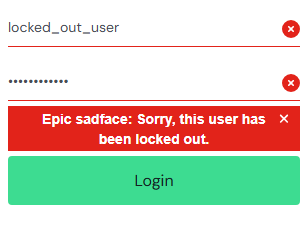 |

| Catalogue | Fiche produit | Panier |
| --- | --- | --- |
| 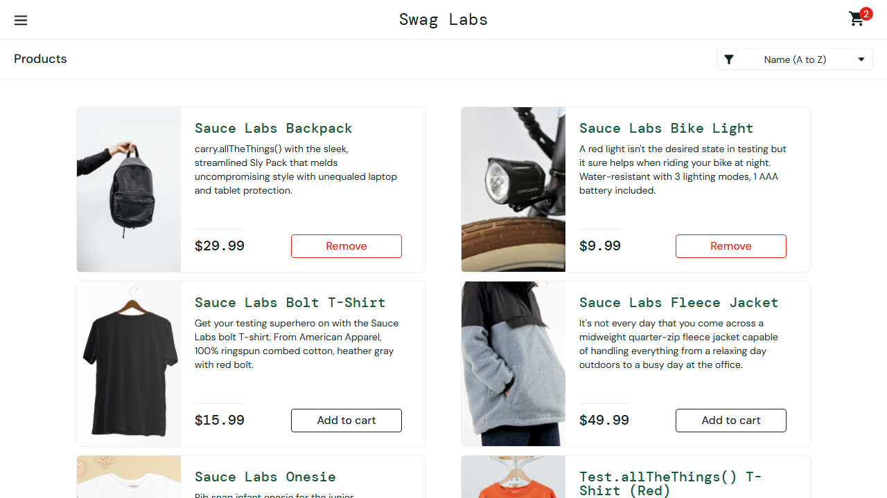 | 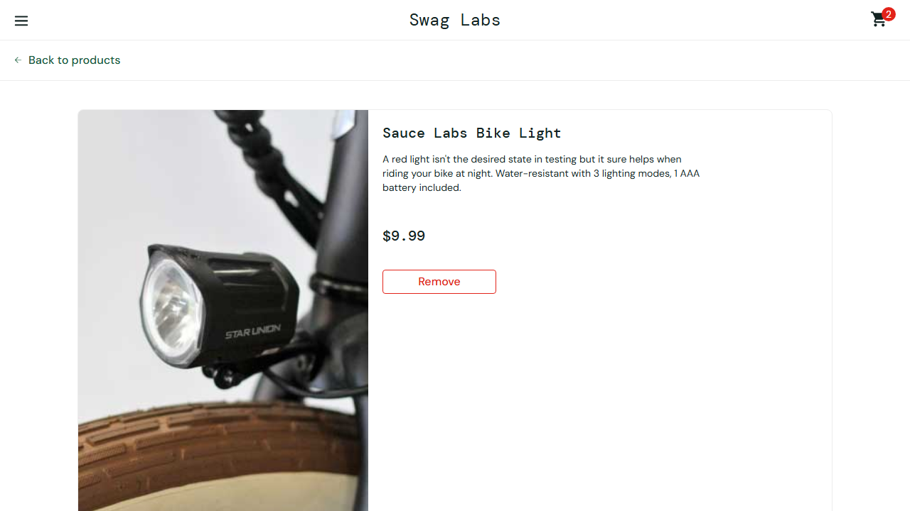 | 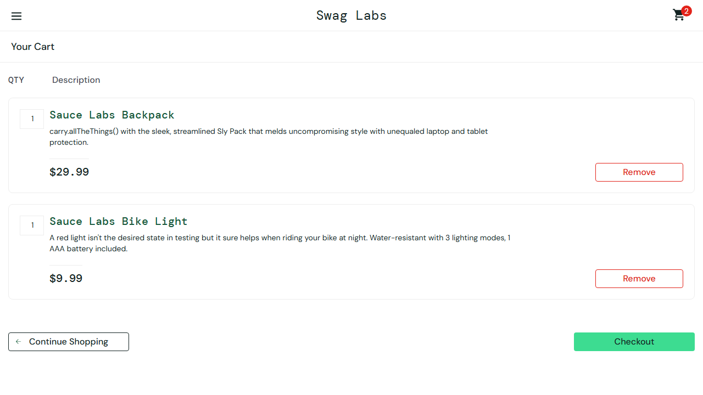 |

### Hypothèses

- La **release 1.0** couvre la connexion, le catalogue et le panier, en **deux sprints** de deux
  semaines.
  - Sprint 1 : connexion et catalogue (sprint terminé).
  - Sprint 2 : panier (sprint en cours).
- Le **parcours de commande** (checkout) n'est **pas développé**. Ses stories restent dans le
  backlog, sans test.
- Avec `problem_user`, Swag Labs présente de vrais défauts. Les tests les révèlent :
  - le bouton « Remove » du catalogue ne retire pas le produit ;
  - trois produits ne peuvent pas être ajoutés au panier.

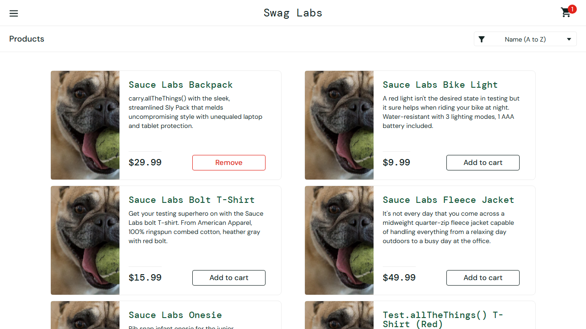

### L'équipe

Chaque compte de démonstration a un rôle dans le projet (mot de passe : `demo`).

| Compte | Personne | Rôle dans le projet | Ce qu'il fait dans ce guide |
| --- | --- | --- | --- |
| `admin` | Administrateur | Administrateur | Crée le projet, gère l'équipe et le serveur d'exécution |
| `po` | Paula Owner | Product Owner | Écrit le backlog, planifie, approuve les débriefings, rend le verdict |
| `qa1` | Quentin Testeur | Testeur | Conçoit les tests, prépare les campagnes, explore le panier |
| `qa2` | Quitterie Testeuse | Testeuse | Exécute le test manuel du panier |
| `dev` | Dev Eloppeur | Développeur | Référence les tests automatisés, lance les runs |
| `viewer` | Victor Lecteur | Lecteur | Consulte sans rien modifier |

> **Principe — une qualité partagée.** En agile, la qualité n'est pas l'affaire d'une équipe de
> test en bout de chaîne. Le PO formule des critères vérifiables, les testeurs et les développeurs les
> transforment en tests, et toute l'équipe lit les mêmes indicateurs. TraceAgile donne à chacun ses
> droits ; l'API applique ces droits même si l'interface masque une action.

---

## 2. Administration

L'administrateur crée le projet. Sa **clé** (`SWAG`) préfixe toutes les URL.

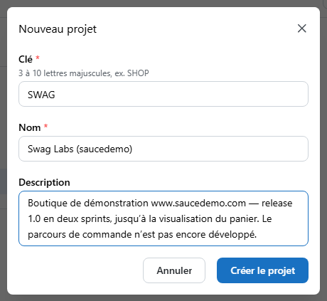

Il affecte ensuite un rôle à chaque membre (**Administration › Projets**).

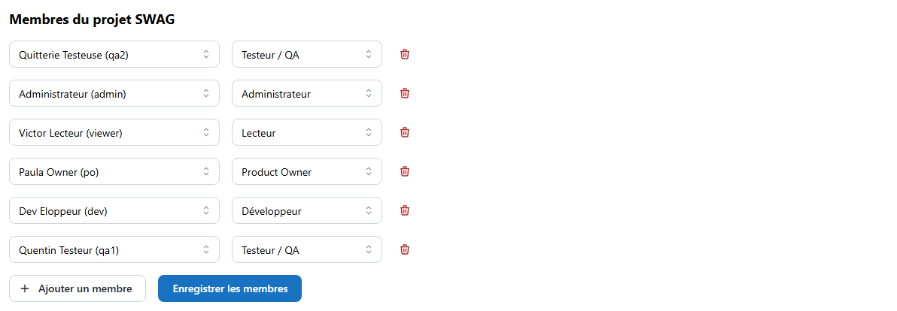

L'onglet **Utilisateurs** liste les comptes. L'onglet **Serveurs d'exécution** montre les serveurs
qui jouent les tests automatisés :
- le **serveur d'exécution** réel, qui exécute vraiment les tests (voir le [chapitre 15](#15-le-serveur-dexécution)) ;
- le **simulateur**, qui imite un serveur pour les démonstrations.

Chacun est **appairé** par un jeton qu'il a lui-même émis et apparaît **en ligne**, avec les
techniques qu'il sait exécuter.

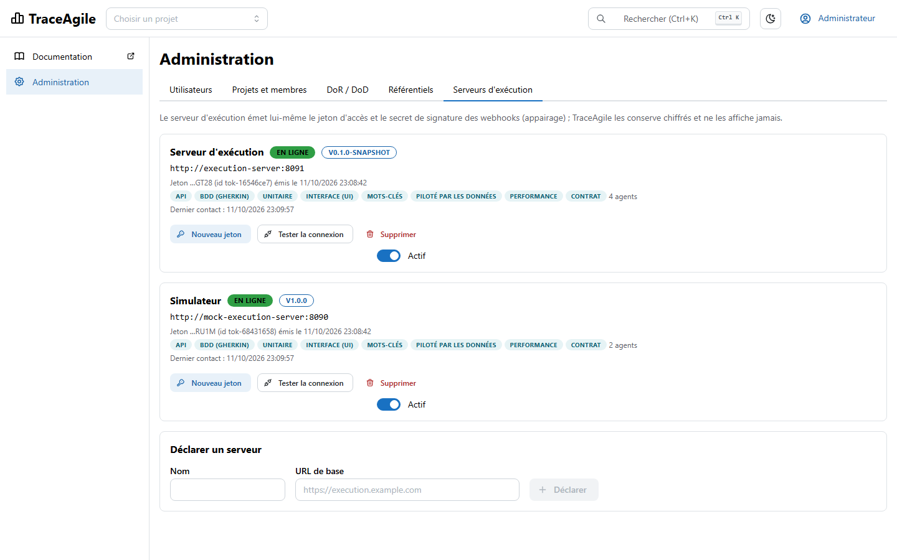

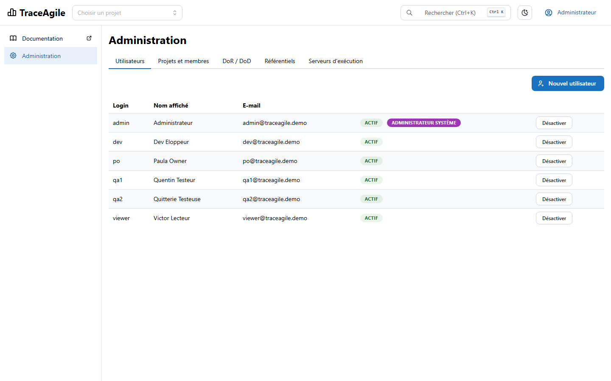

La page **Projets** résume chaque projet.

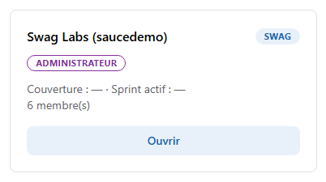

---

## 3. Exprimer le besoin

### Le backlog

Le PO organise le besoin en arbre :

- un **épic** (« Acheter en ligne sur Swag Labs ») ;
- quatre **features** : Authentification, Catalogue, Panier, Commande ;
- des **user stories** sous les features ;
- deux **exigences non fonctionnelles** (ENF) transverses.

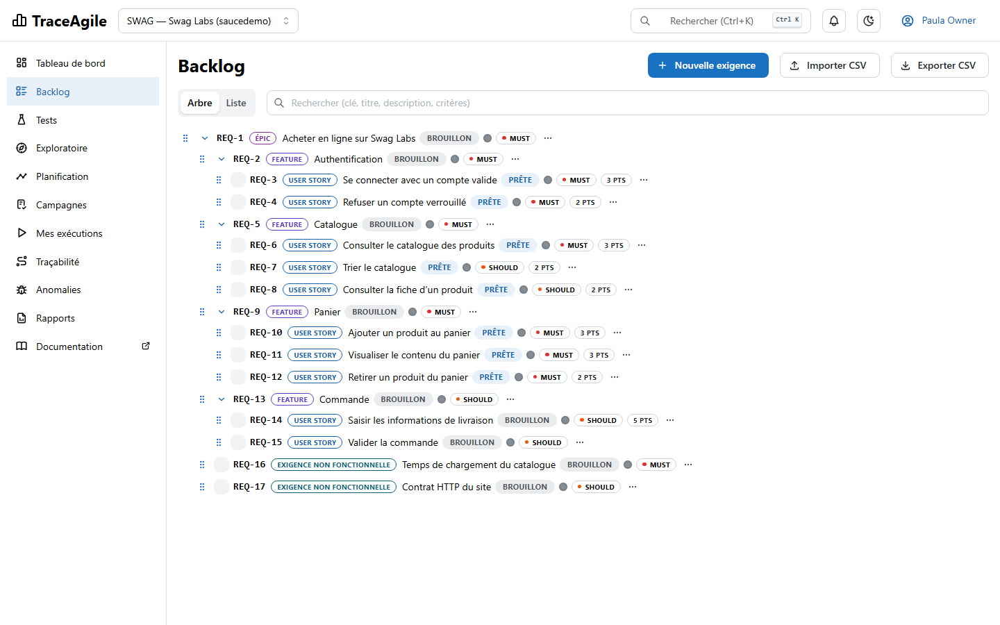

La vue **liste** se filtre et se trie (statut, priorité, risque, vérification) :

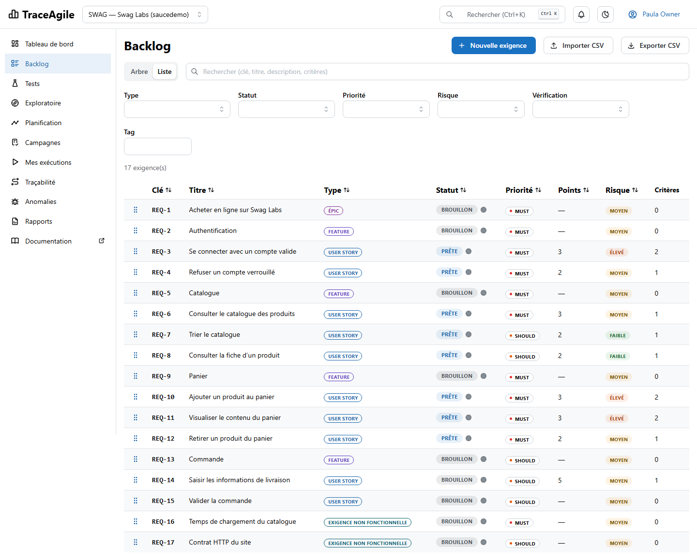

Une story se crée depuis le backlog. La phrase « En tant que… je veux… afin de… » s'affiche pendant
la saisie :

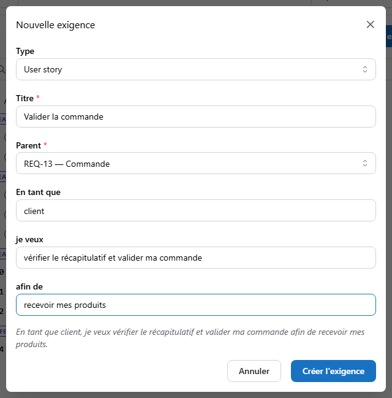

### La fiche d'une story

La fiche regroupe :

- la phrase utilisateur, les points, la priorité MoSCoW et le risque ;
- la grille **INVEST** ;
- la **Definition of Ready** (DoR) et la **Definition of Done** (DoD) ;
- les ENF transverses qui s'appliquent.

Le bandeau indique le **statut de vérification**, calculé par la traçabilité : ici « Non couverte »,
car aucun test n'existe encore.

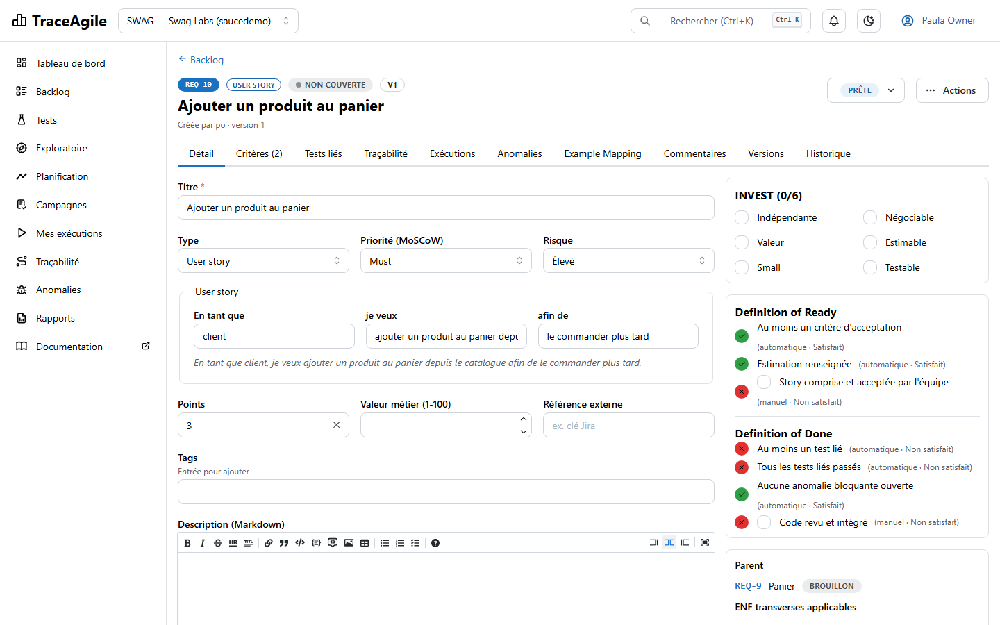

### Critères d'acceptation : texte ou Gherkin

Les critères disent quand la story est acceptée. Ils peuvent être écrits en texte libre ou en
**Gherkin** (« Étant donné… Quand… Alors… »). Le Gherkin est vérifié pendant la saisie. Il servira
plus loin à générer un test BDD.

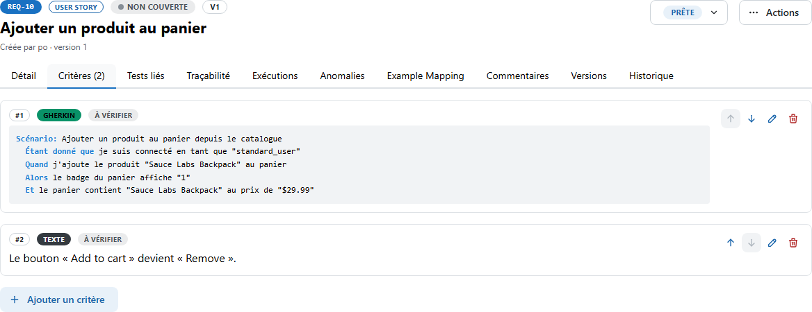

> **Principe — tester dès la conception (« shift left »).** Un critère écrit avant le développement
> est déjà un test : il lève les ambiguïtés et fixe ce qui sera vérifié.

### Exigences non fonctionnelles (Planguage)

Une ENF se décrit avec la méthode **Planguage** :

- une échelle ;
- une méthode de mesure ;
- un **seuil** minimal ;
- une **cible** ;
- une **unité**.

« Temps de chargement du catalogue » a un seuil de 3 000 ms et une cible de 1 000 ms. Elle est
**transverse** : elle s'applique à tout le produit.

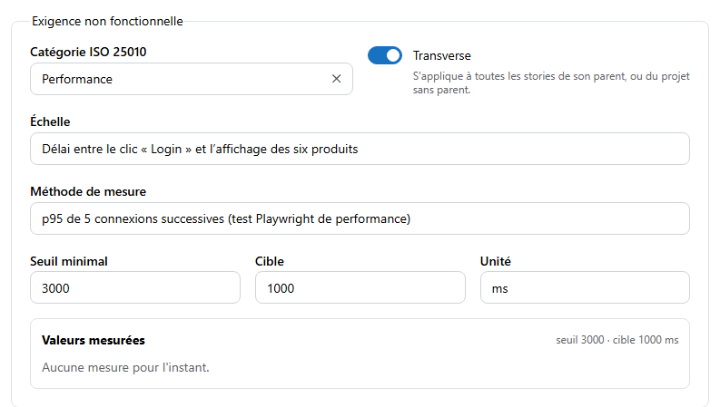

### Definition of Ready

Pour passer une story à « Prête », TraceAgile vérifie la DoR :
- les items automatiques sont calculés (au moins un critère, une estimation) ;
- les items manuels sont confirmés par le PO (« Story comprise et acceptée par l'équipe »).

Une story prête devient planifiable. Une **version v1** est figée à ce moment.

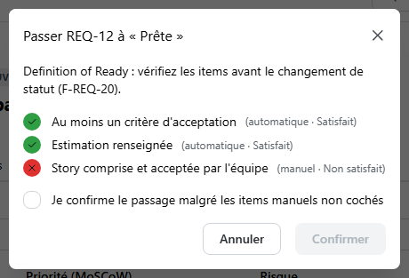

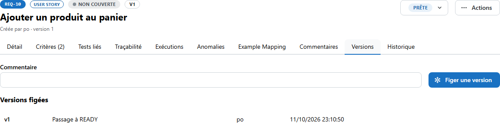

### Atelier Example Mapping

Avant de rendre prête « Saisir les informations de livraison », le PO anime un atelier **Example
Mapping** :

- **règles** (cartes bleues) ;
- **exemples** (cartes vertes) ;
- **questions** (cartes rouges).

Une question ouverte **empêche** le passage à « Prête » tant qu'elle n'est pas résolue. Un exemple
peut devenir un critère Gherkin d'un clic.

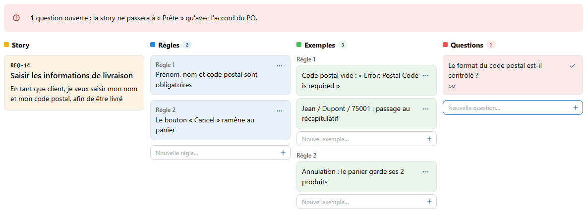

### Commentaires

Chaque exigence porte un fil de commentaires en Markdown, avec mentions et pièces jointes. Un
commentaire peut être marqué comme **question**. Comme celles de l'atelier, une question ouverte
bloque alors la DoR.

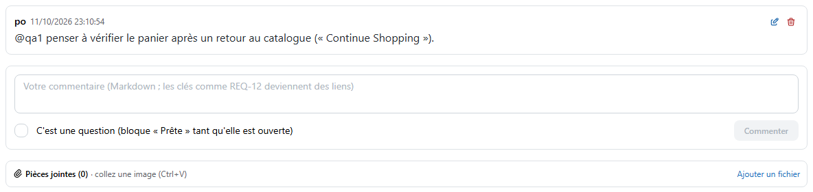

---

## 4. Concevoir les tests

Le référentiel range les tests par dossier. Le jeu de données contient **un exemple de chaque
nature** :

| Nature | Exemple | Particularité |
| --- | --- | --- |
| Manuel | TC-1 « Se connecter avec les comptes de démonstration » | Paramètres et **jeu de données de 3 lignes** |
| Manuel | TC-2 « Retirer un produit depuis le catalogue et le panier » | Révèle le défaut de problem_user |
| Automatisé, piloté par les données | TC-3 « Connexion pilotée par les données » | Même jeu « Comptes » que TC-1 (`data/comptes.json`) |
| Automatisé UI (Playwright) | TC-4, TC-5, TC-6, TC-9, TC-10 | Catalogue et panier |
| Automatisé API | TC-7 « Contrat HTTP : manifeste et icônes » | Vérifie l'ENF « Contrat HTTP du site » |
| Automatisé BDD (Gherkin) | TC-8 « Ajouter un produit au panier depuis le catalogue » | **Généré** depuis le critère de REQ-10 |
| Automatisé performance | TC-11 « Performance : chargement du catalogue » | Alimente l'ENF « Temps de chargement » |
| Exploratoire | TC-12 « Explorer le panier » | Charte de session |

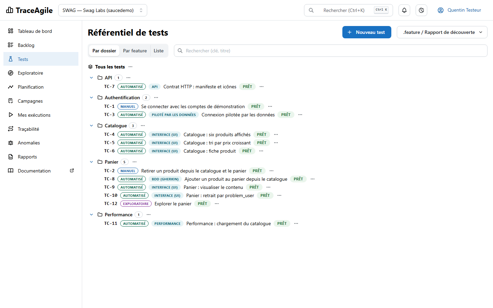

### Test manuel : pas, paramètres, jeu de données

Un test manuel est une suite de pas « action / résultat attendu ». Chaque `${nom}` écrit dans un pas
devient un **paramètre**. Un **jeu de données** donne une valeur à chaque paramètre, une ligne par
exécution :

- TC-1 se jouera trois fois, avec `standard_user`, `locked_out_user` et `problem_user` ;
- le test est marqué « candidat à l'automatisation », car TC-3 l'automatise.

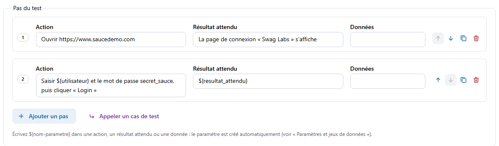

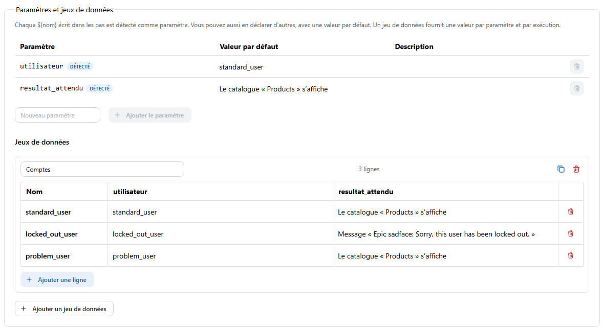

### Test automatisé

Un test automatisé référence le code qui l'exécute :

- **technique** et **framework** ;
- dépôt, branche et chemin ;
- **identifiant** : le nom du test dans le rapport.

L'identifiant permet de rattacher les résultats, qu'ils viennent du serveur d'exécution ou d'un
rapport JUnit importé. Un test automatisé peut aussi avoir un jeu de données : TC-3 rejoue les trois
comptes, comme TC-1.

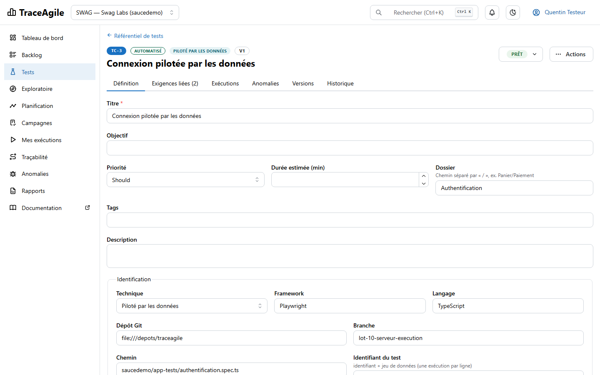

### Test BDD généré depuis un critère

Sur la story « Ajouter un produit au panier », le bouton **Générer un test** du critère Gherkin crée
le test TC-8 :

- le test est lié à la story **et au critère** ;
- son scénario porte les tags `@REQ-10 @AC-10-1`.

Le même scénario est joué par Playwright dans le dépôt
([features/panier.feature](../../saucedemo/features/panier.feature)).

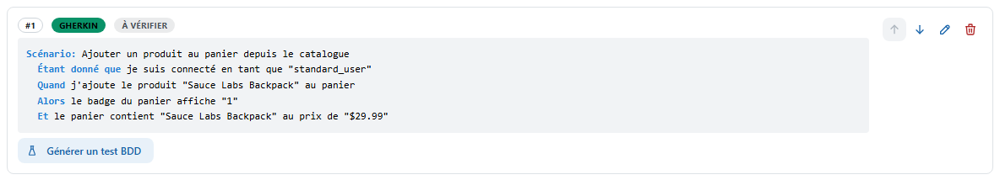

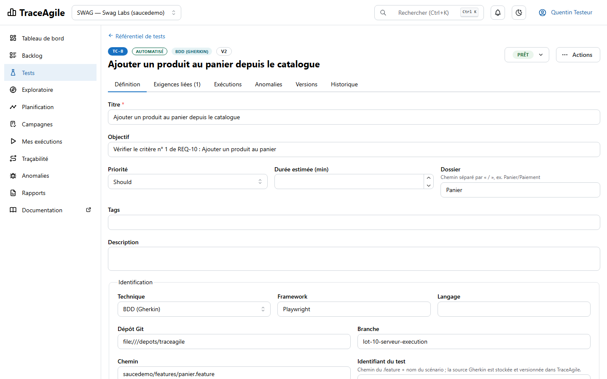

### Charte exploratoire

Une charte décrit une mission : « Explorer *le panier* avec *les comptes standard_user et
problem_user…* pour découvrir *les écarts entre le badge, les boutons et le contenu* ». Elle précise
aussi :
- une durée cible ;
- des zones ;
- des heuristiques (CRUD, Goldilocks) ;
- le risque visé.

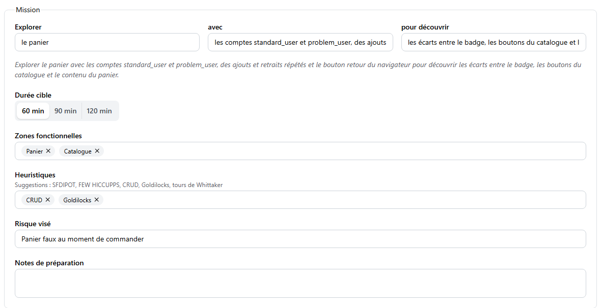

> **Principe — combiner les approches.** Les tests automatisés vérifient vite et souvent ce qu'on
> sait décrire (régression). Les tests manuels couvrent ce qui demande un jugement. L'exploratoire
> trouve ce que personne n'avait prévu. TraceAgile suit les trois de la même façon : liens aux
> exigences, campagnes, résultats.

---

## 5. Planifier la release

La release « Swag Labs 1.0 » contient deux sprints. Dans **Planification › Planification de
sprint**, le PO fait passer les stories **prêtes** dans le sprint :

- par glisser-déposer, ou avec le bouton → ;
- la jauge compare la charge (12 points) à la capacité (13 points).

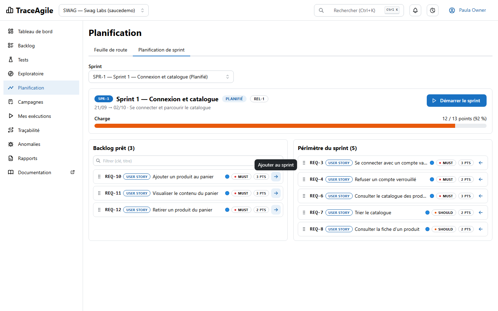

La **feuille de route** montre la frise de la release. Pour chaque sprint, elle affiche sa charge et
son taux de validation (sprint 1 clos, sprint 2 actif).

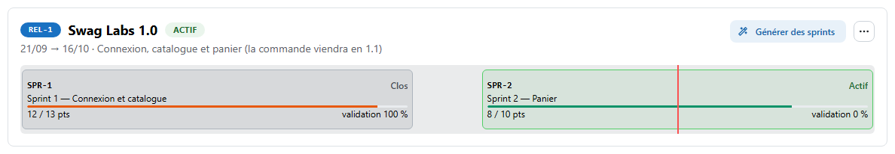

---

## 6. Sprint 1 : recette et clôture

### Campagne de sprint

Une **campagne** regroupe les tests à jouer pour un périmètre (sprint, release ou régression), sur
un environnement et un build. Par défaut, le formulaire propose le sprint actif.

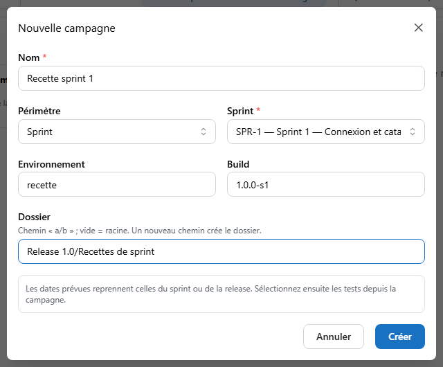

Dans la campagne :

- la sélection **« Tests des exigences du sprint »** ajoute les tests liés aux stories du sprint ;
- TC-1 est **décliné sur les trois lignes** de son jeu de données ;
- le test d'API, lié à une ENF transverse, est ajouté à la main.

Chaque ligne a un **score de risque** (risque × priorité), un testeur et son dernier résultat.

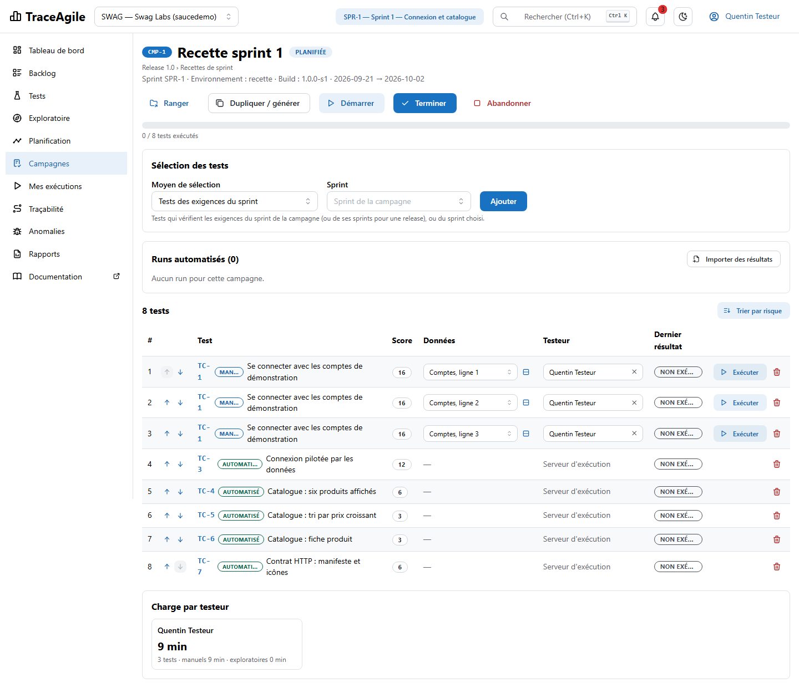

### Exécution manuelle pas à pas

Dans **Mes exécutions**, chaque testeur retrouve ce qui lui est affecté. L'exécution montre un pas
à la fois, avec les **paramètres remplacés** par la valeur de la ligne (`standard_user`). Pour
chaque pas, le testeur choisit Réussi, Échoué, Bloqué ou Ignoré. Les touches **P**, **F** et **B**
marquent le pas courant réussi, en échec ou bloqué.

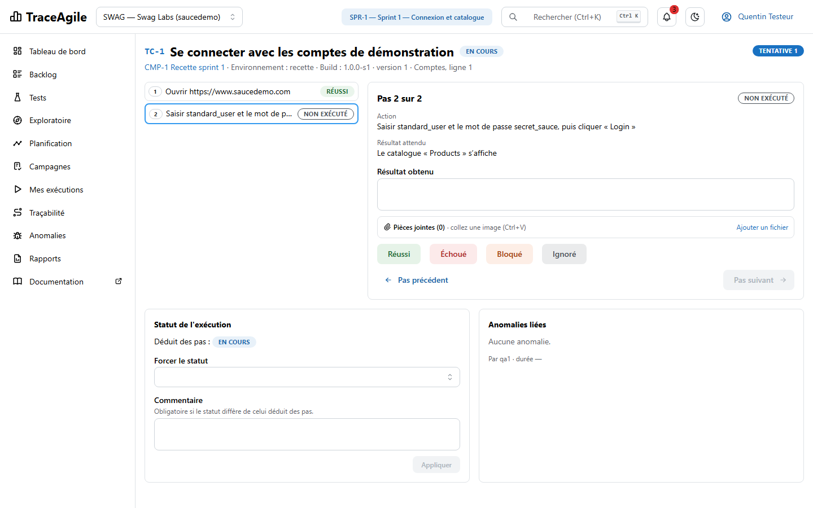

### Run automatisé

Le développeur lance les cinq tests automatisés de la campagne sur le **serveur d'exécution** :

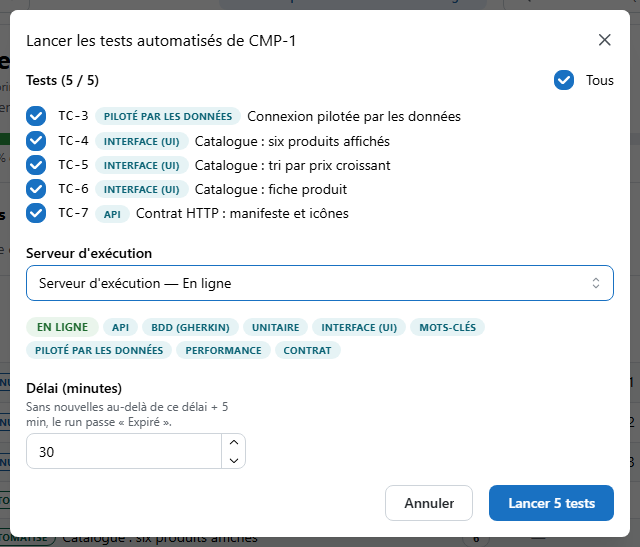

Le serveur clone le dépôt, installe les dépendances du projet (`npm ci`, navigateur Chromium) et lance
chaque test Playwright, quatre à la fois. Les résultats arrivent **en temps réel** :
- les webhooks signés du serveur sont relayés au navigateur en SSE ;
- chaque test a son identifiant (le nom du test Playwright), son résultat et sa durée réelle ;
- les **artefacts** sont consultables : journal de chaque test, traces système, JUnit XML, rapport.

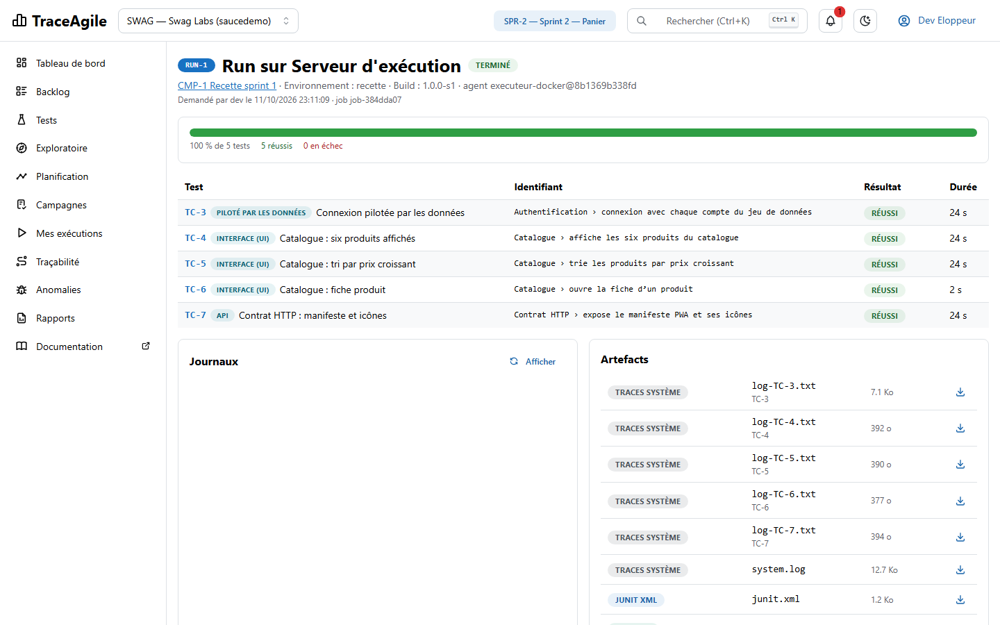

La campagne est complète : 8 exécutions sur 8, 100 % de réussite.

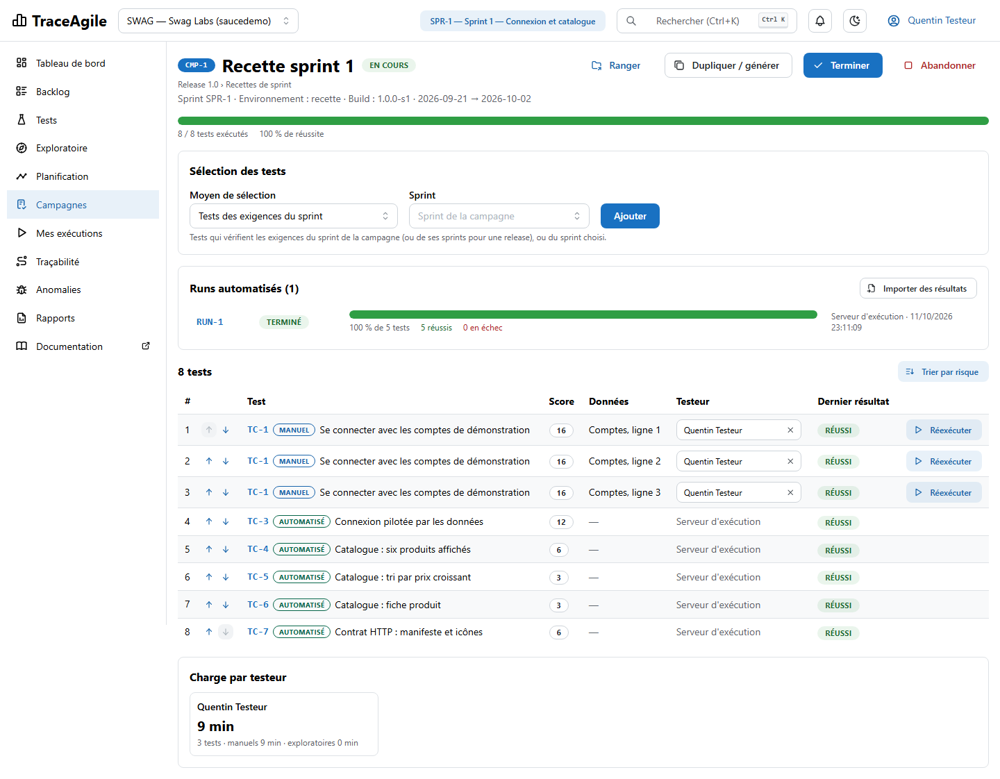

### Definition of Done et clôture du sprint

Le PO passe les stories validées à « Terminée ». La DoD est vérifiée :
- tests liés passés (automatique) ;
- code revu (manuel).

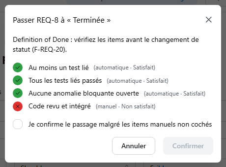

À la clôture, une story non terminée est **renvoyée au backlog** ou **reportée** au sprint suivant.
Ici, toutes sont terminées. Le **bilan du sprint** est alors **figé** : il reste consultable tel
quel par son lien permanent.

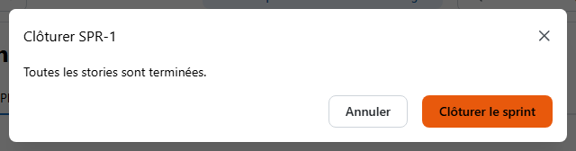

---

## 7. Sprint 2 : un échec manuel devient une anomalie

La campagne « Recette sprint 2 » répartit le travail :

- le test manuel TC-2 est confié à `qa2` ;
- la charte exploratoire TC-12 est confiée à `qa1` ;
- les tests automatisés sont joués par le serveur d'exécution.

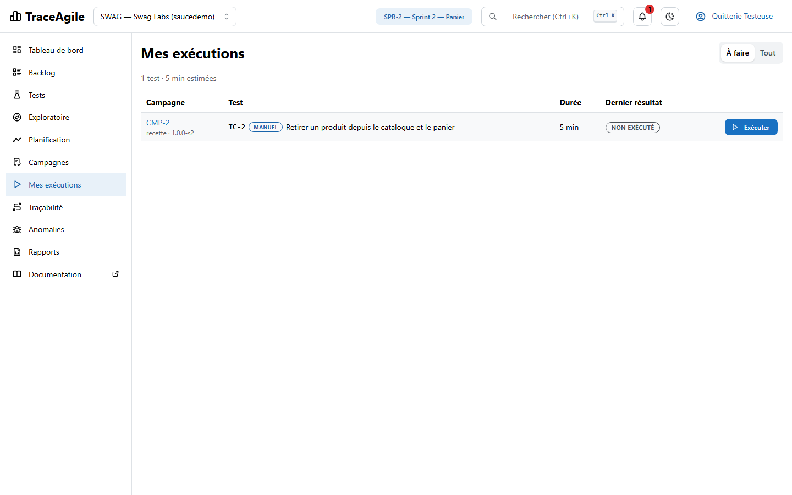

Avec `problem_user`, le pas 4 échoue. La testeuse :
- saisit le **résultat obtenu** ;
- **joint la capture** du défaut au pas (bouton « Ajouter un fichier », ou collage d'une image) ;
- marque le pas « Échoué ». Le statut de l'exécution est **déduit** des pas.

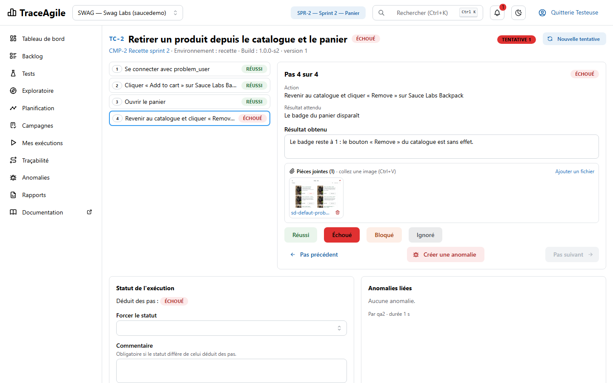

**Créer l'anomalie** depuis le pas pré-remplit :

- le titre ;
- les étapes pour reproduire, l'attendu et l'obtenu ;
- l'environnement et le build ;
- les exigences liées.

La capture du pas est reprise dans l'anomalie.

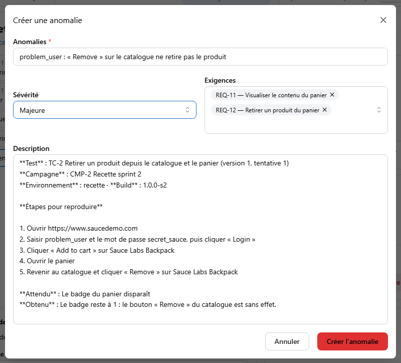

---

## 8. Test exploratoire du panier

L'onglet **Exploratoire** liste les chartes à jouer et les sessions. Le testeur démarre la session
de sa charte :

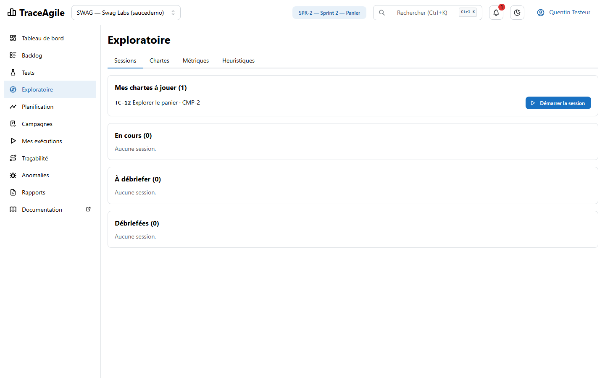

### Prendre des notes

Pendant la session (minuteur, durée cible de 60 min), le testeur note ce qu'il observe. Chaque
note est horodatée et typée au clavier :

| Raccourci | Type de note |
| --- | --- |
| Ctrl+1 | Note |
| Ctrl+2 | Question |
| Ctrl+3 | Problème |
| Ctrl+4 | Bogue |
| Ctrl+5 | Idée |

Le brouillon est enregistré toutes les 10 secondes.

Ici, l'exploration trouve un **vrai défaut** : avec `problem_user`, « Add to cart » est sans effet
sur trois produits.

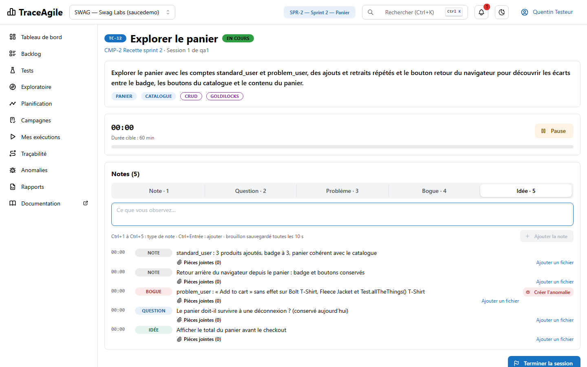

### Du bogue à l'anomalie, puis le TBS

Un clic sur **Créer l'anomalie** transforme la note « Bogue » en anomalie (DEF-2). L'anomalie est
liée à la charte et aux stories.

En fin de session, le testeur répartit son temps selon le modèle **TBS** :
- Test ;
- Bug (investigation des bogues) ;
- Setup (préparation).

Le statut de la session est déduit des notes : « Échoué », car il y a un bogue.

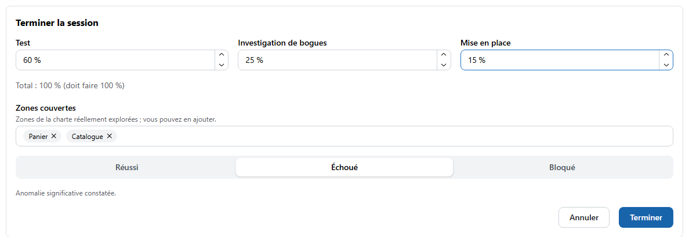

### Débriefing PROOF et approbation

Le débriefing suit la méthode **PROOF** :
- **P**assé : ce qui a été fait ;
- **R**ésultats ;
- **O**bstacles ;
- **O**utlook : perspectives ;
- **F**eelings : ressenti.

Le PO relit le débriefing et l'**approuve** : la session est « Débriefée ».

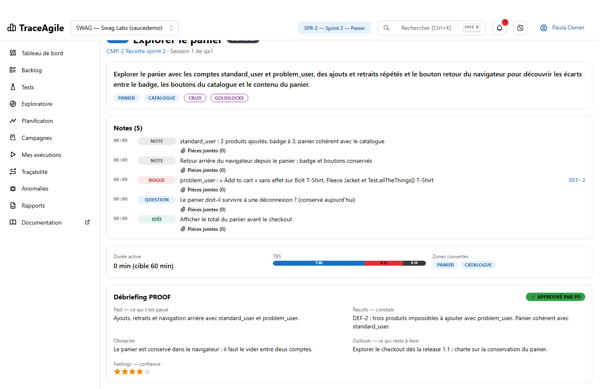

> **Principe — l'exploratoire se pilote.** Le test exploratoire par sessions (SBTM) est cadré par
> une mission, une durée et un débriefing. Il est mesurable (sessions, TBS) et ses découvertes
> rejoignent le circuit des anomalies.

---

## 9. Exécution automatisée

Le développeur lance les quatre tests automatisés du sprint 2 sur le serveur d'exécution. TC-10
échoue pour de vrai : c'est le défaut de `problem_user`. Le run affiche :

- le **message d'erreur** du test ;
- les **journaux** du serveur ;
- les **artefacts**.

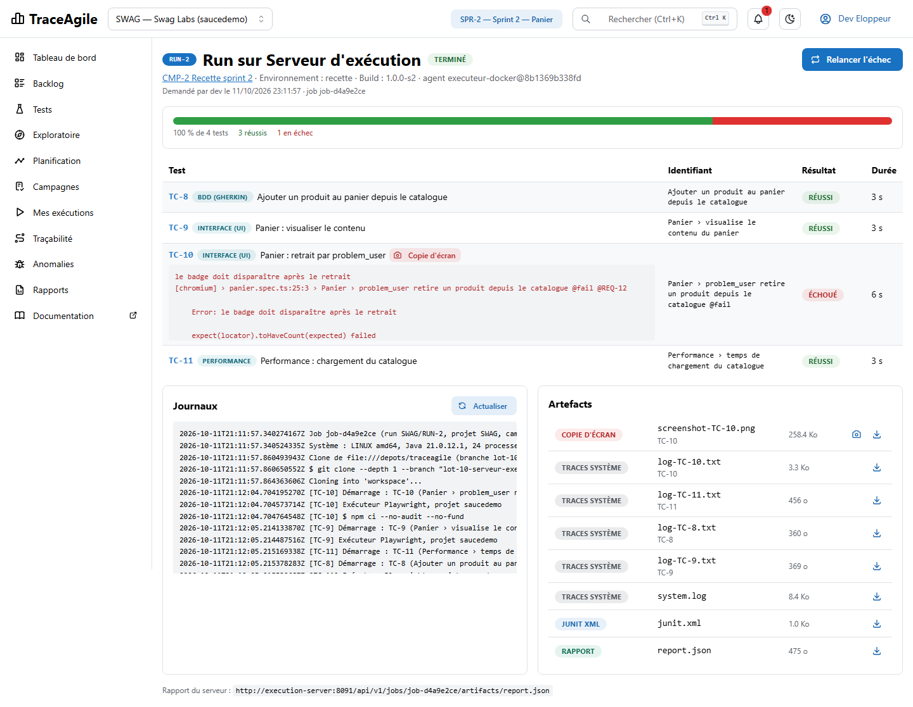

Pour chaque test en échec, la **copie d'écran** prise par Playwright au moment de l'échec s'ouvre en
un clic : le bouton « Remove » est toujours affiché et le badge du panier reste à 1. Les artefacts se
téléchargent : journal de chaque test, traces système, JUnit XML et rapport du serveur.

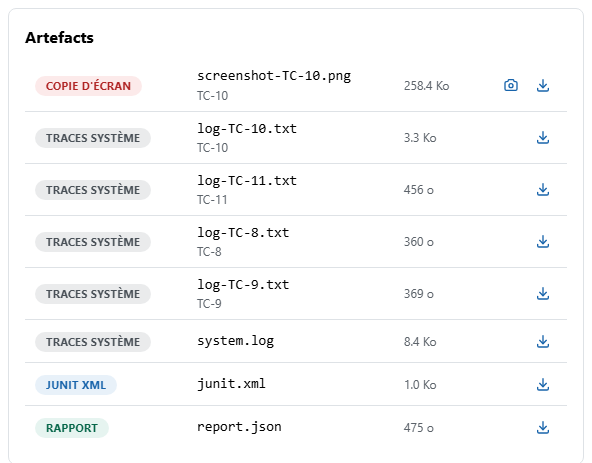

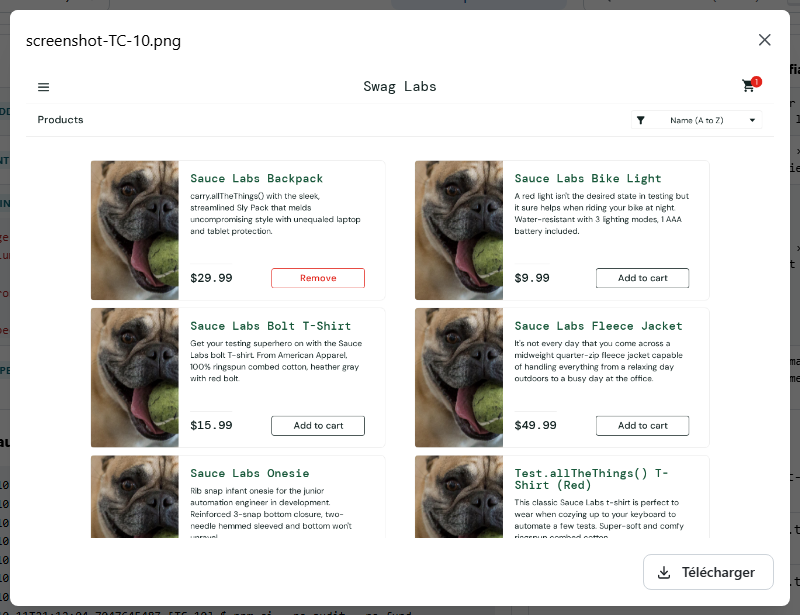

### Valeur mesurée d'une ENF

Le test de performance TC-11 est lié à l'ENF « Temps de chargement du catalogue ». Exécuté par le
serveur, il mesure le p95 de cinq connexions et dépose sa métrique `p95Ms` dans un fichier
`metrics.json`. Elle devient une **valeur mesurée**, comparée au seuil et à la cible. Une mesure peut
aussi être saisie à la main.

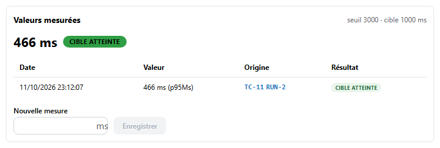

> Le test échoue au-delà du seuil de 3 000 ms. Le serveur d'exécution lit les métriques que tout test
> dépose dans le dossier `TRACEAGILE_OUTPUT_DIR`.

---

## 10. Intégration continue : import JUnit

Les tests du dépôt tournent aussi dans la chaîne d'intégration continue. Leur rapport **JUnit XML**
(ou Jest JSON, Cucumber JSON, Robot Framework, Playwright JSON) s'importe dans une campagne, ici « Intégration continue — main »,
de périmètre release.

L'aperçu rapproche chaque résultat d'un test TraceAgile par son **identifiant**. On peut aussi
rapprocher par un tag `@REQ-n` ou créer les tests inconnus.

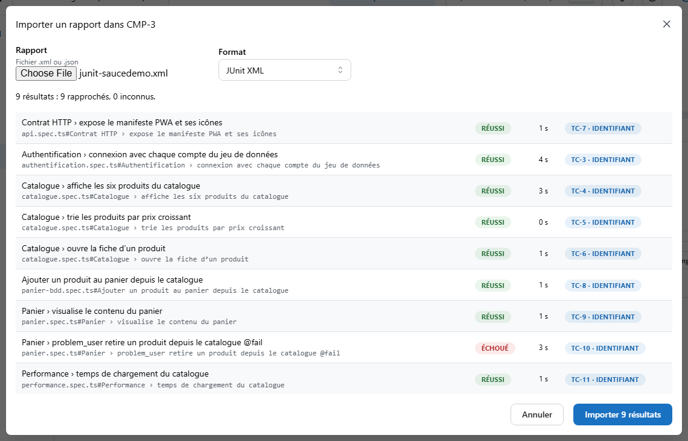

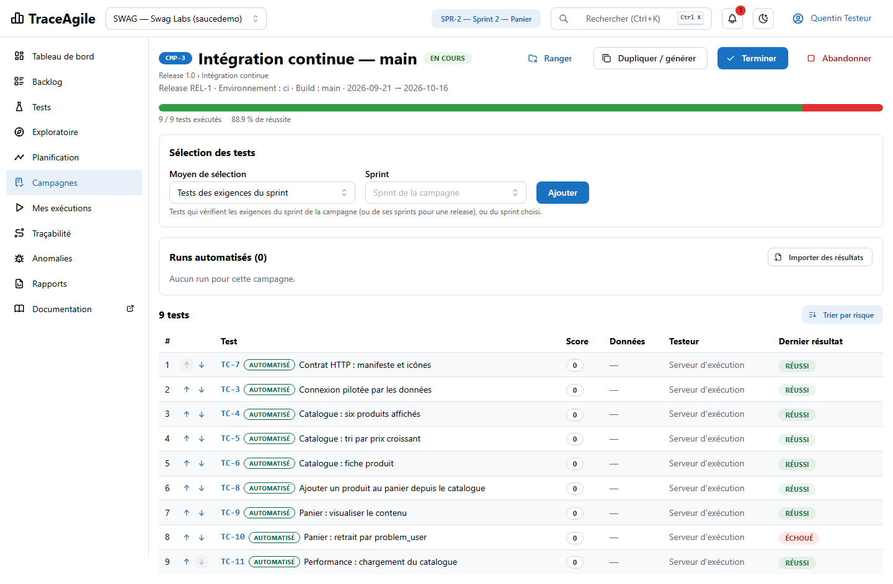

Les campagnes se rangent dans des dossiers (« Release 1.0/Recettes de sprint », « Release
1.0/Intégration continue ») :

---

## 11. Traçabilité

### Matrice

La matrice croise exigences et tests. Chaque case indique le type de lien :

| Case | Type de lien |
| --- | --- |
| V | vérifie |
| PV | vérifie partiellement |
| R | informatif |

Chaque exigence porte une pastille de **statut de vérification** :

| Statut | Signification |
| --- | --- |
| Non couverte | aucun test lié |
| Non exécutée | tests liés jamais joués |
| Validée | la dernière exécution de chaque test lié a réussi |
| En échec | au moins un test lié a échoué |
| Suspecte | l'exigence a changé depuis la conception du test |

Le statut remonte des stories vers les features et l'épic. On lie un test d'un clic sur une case
vide. La matrice s'exporte en CSV et en PDF.

Restreinte à la feature Panier, la matrice montre la cause du rouge : TC-2, TC-10 et la session
exploratoire ont échoué.

### Couverture et orphelins

La **couverture** distingue deux taux :
- **conception** : des tests existent ;
- **validation** : les tests ont réussi.

Les **orphelins** montrent les exigences sans test et les tests sans exigence. Ici, ce sont les
stories du checkout, non développé.

### Arbre de traçabilité d'une exigence

Depuis la fiche d'une story, l'onglet **Traçabilité** montre ses critères, ses tests et leurs
derniers résultats. L'onglet **Anomalies** liste les anomalies liées, directement ou par ses tests.

Côté test, l'onglet **Exécutions** garde l'historique. TC-1 y apparaît avec la ligne du jeu de
données jouée par chaque exécution.

### Analyse d'impact et suspicion

Quand le PO modifie une exigence déjà testée, ses tests liés deviennent **à revoir**, et le lien
est **suspect**. L'analyse d'impact les liste. Le testeur relit chaque test et le marque **revu**,
ce qui lève l'alerte.

> **Principe — la traçabilité bidirectionnelle.** On sait à tout moment quelles exigences sont
> vérifiées, par quels tests, avec quel résultat. On sait aussi ce qu'il faut revoir quand une
> exigence change.

---

## 12. Anomalies

La page **Anomalies** liste les anomalies, filtrables par sévérité et par statut :

La fiche d'une anomalie contient :
- sa sévérité et son statut (cycle de vie) ;
- sa référence externe (Jira, GitLab…) ;
- ses exigences et ses exécutions liées ;
- ses **pièces jointes** : ici, la capture reprise du pas en échec.

---

## 13. Tableau de bord, bilans et rapports

### Tableau de bord

Le tableau de bord du projet regroupe :

- le **sprint actif** (jours restants, points terminés) ;
- la couverture de **conception** et de **validation** du sprint et de la release ;
- la dernière campagne et les **anomalies ouvertes** par sévérité ;
- les **sessions exploratoires** et les **derniers runs** ;
- les graphiques : **burndown** du sprint, **burnup** de la release, taux de réussite des runs,
  anomalies par sprint.

### Bilan de sprint et verdict

Le bilan du sprint 1 a été **figé** à la clôture. Il reste consultable tel qu'il était.

Le PO génère le bilan du sprint 2 en cours. Il contient huit sections :
1. synthèse ;
2. livraison ;
3. couverture ;
4. exécution ;
5. exploratoire ;
6. anomalies ;
7. risques résiduels ;
8. recommandation.

Le **verdict** est calculé par les règles de verdict : ici « No go », avec un taux de validation de
33 % et deux anomalies majeures ouvertes.

Le PO peut **trancher** : il passe le verdict à « Go sous réserve », avec un commentaire
obligatoire. Le verdict calculé reste affiché à côté.

Un rapport s'exporte en HTML, PDF, Word, Excel, Markdown, CSV ou JSON.

### Modèles et règles

Chaque équipe compose ses **modèles de rapport** : sections choisies et ordonnées, graphiques,
format par défaut.

Les **règles de verdict** du projet fixent les seuils du « Go » et du « Go sous réserve ».

---

## 14. Se repérer vite

**Recherche globale** (Ctrl+K) : exigences, tests, campagnes, anomalies, par clé ou par mot.

**Aperçu des clés** : le survol d'une clé (REQ-n, TC-n, DEF-n…) en affiche un résumé.

**Raccourcis clavier** : `?` affiche l'aide.

**Notifications** : la cloche signale ce qui attend l'utilisateur.

**Thème sombre** : bouton de la barre supérieure.

**Documentation** : l'entrée du menu latéral, sous Rapports, ouvre ce guide dans un nouvel onglet.

**Lecture seule** : un lecteur consulte tout, sans pouvoir modifier.

---

## 15. Le serveur d'exécution

Le serveur d'exécution est livré à part : un jar autonome, lançable sur toute machine Windows, Linux
ou macOS, ou dans Docker (service `execution-server`, http://localhost:8091). Il a sa propre
interface ; on s'y connecte avec l'administrateur du serveur.

### Suivi

Le tableau de bord montre :
- l'activité en direct : jobs en cours, agents occupés ;
- le taux de réussite et les volumes sur 7 jours ;
- les tests exécutés par jour ;
- les résultats par framework ;
- les tests les plus en échec ;
- la part des outils installés.

### Jobs

Chaque run lancé depuis TraceAgile devient un **job**. La liste se filtre par statut et par texte.

Le détail d'un job montre :
- le dépôt et la branche clonés ;
- l'agent, la durée, le parallélisme ;
- chaque test avec son framework, son fichier, son résultat et ses métriques (ici `p95Ms` pour le
  test de performance).

Le job se suit en direct et peut être annulé.

Le **journal** retrace chaque commande : clone, `npm ci`, installation de Chromium, `npx playwright
test` filtré sur le titre du test.

Les **artefacts** sont ceux que TraceAgile affiche : copies d'écran, journaux, JUnit XML, rapport.

### Outils

Le serveur **détecte** les prérequis de la machine : Java, Node.js, Python, Git. Il **installe sans
droits d'administrateur**, dans son dossier d'outils :
- les JDK et Maven ;
- JUnit et Gatling ;
- Playwright, Cypress, Selenium ;
- Robot Framework et ses bibliothèques SeleniumLibrary et Browser.

Ici, Playwright apparaît absent comme outil du serveur. Le serveur n'en a pas besoin : chaque job
utilise la version de Playwright du dépôt, installée par `npm ci`.

Chaque outil a son aide :
- les prérequis ;
- les commandes exactes de l'installation, pour Windows (PowerShell) ou Linux et macOS (bash) ;
- le journal de la dernière installation.

L'**assistant d'installation** part des frameworks utilisés par les tests. Il propose le plan dans
l'ordre, dépendances d'abord, et l'installe en un clic.

### Jetons de sécurité

Le serveur émet les **jetons** qui autorisent une instance de TraceAgile, avec le secret de signature
des webhooks. Il ne les affiche qu'une fois et peut les révoquer. Ici, TraceAgile a demandé lui-même
son jeton, avec les identifiants de l'administrateur.

> Mode d'emploi complet (lancement du jar, réglages, appairage, frameworks pris en charge) :
> [backend/execution-server/README.md](../../backend/execution-server/README.md).

---

## 16. Annexe : le jeu de données

| Élément | Contenu |
| --- | --- |
| Exigences | REQ-1 épic ; REQ-2, 5, 9, 13 features ; REQ-3, 4, 6, 7, 8 (sprint 1) ; REQ-10, 11, 12 (sprint 2) ; REQ-14, 15 (commande, non développée) ; REQ-16, 17 ENF |
| Tests | TC-1, TC-2 manuels ; TC-3 à TC-11 automatisés (dont TC-8 BDD) ; TC-12 exploratoire |
| Planification | REL-1 « Swag Labs 1.0 » ; SPR-1 clos ; SPR-2 actif |
| Campagnes | CMP-1 « Recette sprint 1 » (terminée) ; CMP-2 « Recette sprint 2 » ; CMP-3 « Intégration continue — main » (import JUnit) |
| Runs | RUN-1 (5/5 réussis) ; RUN-2 (TC-10 en échec), exécutés par le serveur d'exécution |
| Anomalies | DEF-1 (échec manuel de TC-2) ; DEF-2 (bogue de la session exploratoire) |
| Rapports | RPT-1 bilan figé du sprint 1 ; RPT-2 bilan du sprint 2 (verdict tranché par le PO) |

Correspondance entre les tests du dépôt et les tests TraceAgile, et commandes pour régénérer
données et captures : [saucedemo/README.md](../../saucedemo/README.md).
